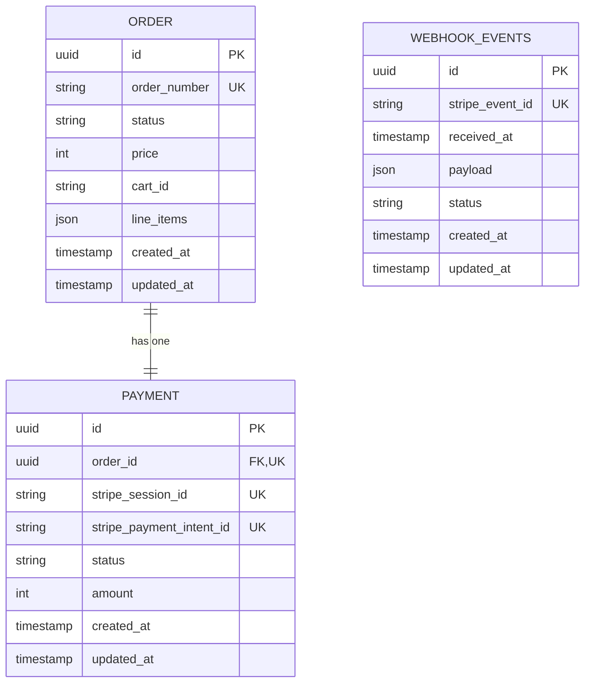

Data model:

1. Can an order have multiple payment attempts, or exactly one payment?
An order can have exactly one payment.

2. Should money be stored as a decimal, a floating-point number, or an integer number of minor currency units?
Integer number of minor currency units.

3. Which Stripe identifiers need to be stored locally?
stripe_payment_intent_id and stripe_session_id

4. Which fields should be immutable once checkout starts?
stripe_session_id

5. What database constraints prevent duplicate Stripe events?
Unique stripe webhook event id on database prevent duplicate Stripe events. storing the same Stripe event twice fails the unique index, so the handler can catch that error and skip the event.

6. Which payment statuses do you need, and which transitions are valid?
SUCCESS, FAILED, PENDING

7. What happens if an order is cancelled while a payment attempt is still processing?
payment should not be valid.

