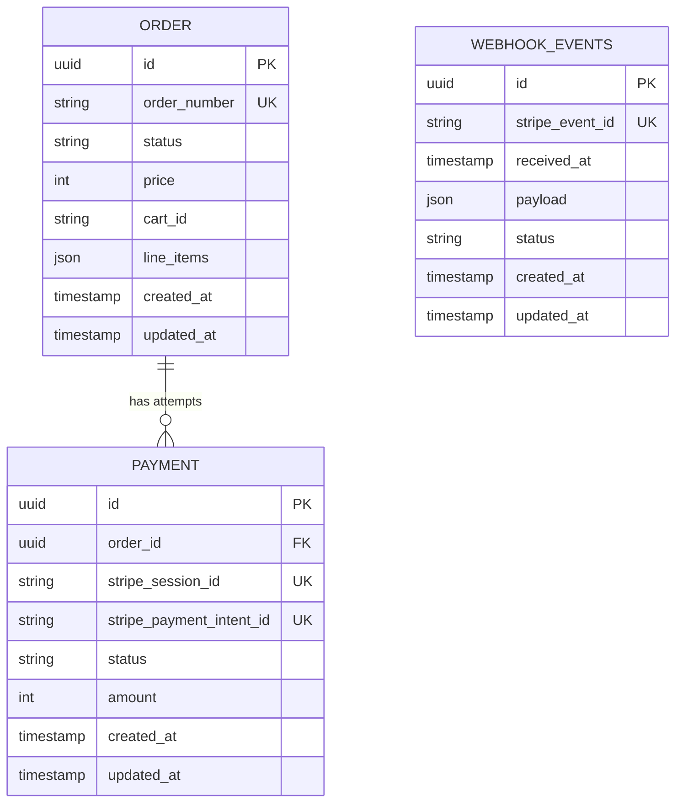

Data model:

1. Can an order have multiple payment attempts, or exactly one payment?
An order can have multiple payment attempts. Each Payment row is one Stripe Checkout Session, so a new attempt (e.g. after the session expires) gets a new row with its own stripe_session_id.

2. Should money be stored as a decimal, a floating-point number, or an integer number of minor currency units?
Integer number of minor currency units.

3. Which Stripe identifiers need to be stored locally?
stripe_payment_intent_id and stripe_session_id

4. Which fields should be immutable once checkout starts?
stripe_session_id (per payment attempt), order amount, currency and the Stripe PaymentIntentID

5. What database constraints prevent duplicate Stripe events?
Unique stripe webhook event id on database prevent duplicate Stripe events. storing the same Stripe event twice fails the unique index, so the handler can catch that error and skip the event.

6. Which payment statuses do you need, and which transitions are valid?
Order, payment and webhook event each have their own status. An order describes what was bought; a payment describes one Checkout Session attempt; a webhook event describes our processing of one Stripe event. Any transition not listed below is invalid.

**Order**

| From | To | Triggered by |
|---|---|---|
| `awaiting_payment` | `paid` | Webhook processing job, when a payment attempt becomes `succeeded` |
| `awaiting_payment` | `cancelled` | Customer/admin cancel action (also expires the open Checkout Session via the Stripe API) |

`paid` and `cancelled` are final.

**Payment** (one row per Checkout Session)

| From | To | Triggered by (Stripe event) |
|---|---|---|
| `pending` | `succeeded` | `checkout.session.completed` with `payment_status = paid`, or `checkout.session.async_payment_succeeded` |
| `pending` | `failed` | `checkout.session.async_payment_failed` |
| `pending` | `expired` | `checkout.session.expired` |

`succeeded`, `failed` and `expired` are final. `checkout.session.completed` with `payment_status = unpaid` (delayed payment methods) leaves the payment `pending`.

**Webhook event**

| From | To | Triggered by |
|---|---|---|
| `received` | `processed` | Processing job finishes successfully |
| `received` | `ignored` | Processing job sees an event type we don't handle |
| `received` | `failed` | Processing job throws |
| `failed` | `processed` | A retry of the processing job succeeds |

`processed` and `ignored` are final. The webhook controller only stores the event as `received` and returns 200, then queues the processing job. Because Stripe does not resend an event after a 200, retrying failed events is our responsibility.

**Who makes transitions**

- Each model has one place that changes its status (e.g. `Payment::markSucceeded()`). Controllers and jobs call it and never set `status` directly.
- Every transition checks the current status and updates conditionally (`UPDATE ... WHERE id = ? AND status = 'pending'`), so a duplicate or out-of-order webhook cannot move a final status backwards.

7. What happens if an order is cancelled while a payment attempt is still processing?
Cancelling the order also expires the open session through the API. If a payment still succeeds for a cancelled order (e.g. `completed` arrives before the expiry takes effect), the payment becomes `succeeded` because the money really moved, the order stays `cancelled`, and the payment is flagged for a refund instead of marking the order paid.

