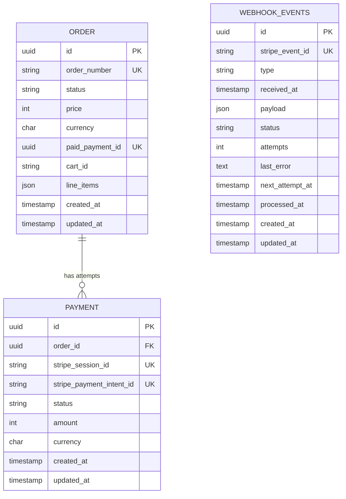

Data model:

1. Can an order have multiple payment attempts, or exactly one payment?
An order can have multiple payment attempts. Each Payment row is one Stripe Checkout Session, so a new attempt (e.g. after the session expires) gets a new row with its own stripe_session_id.

2. Should money be stored as a decimal, a floating-point number, or an integer number of minor currency units?
Integer number of minor currency units.

3. Which Stripe identifiers need to be stored locally?
stripe_payment_intent_id and stripe_session_id

4. Which fields should be immutable once checkout starts?
A field can be immutable without being known up front. "Set once" means null → value is allowed, but value → a different value is rejected.

| Field | Assigned | Rule |
|---|---|---|
| `orders.price`, `orders.currency`, `orders.line_items` | When the order is created | Never change |
| `payments.amount`, `payments.currency` | When the attempt is created | Never change |
| `payments.stripe_session_id` | When the attempt is created (not null) | Never changes |
| `payments.stripe_payment_intent_id` | Later, from a webhook (may not exist when the session is created) | Set once |
| `orders.paid_payment_id` | When the order becomes `paid` | Set once |

Where the amount is authoritative: the order's `price` + `currency` is the stable snapshot of what the customer owes. Each payment's `amount` + `currency` is what that Checkout Session was created to collect. On success, Stripe's `amount_total` and `currency` must match the payment row; a mismatch is flagged and never fulfils the order. Currency is always stored explicitly (lowercase ISO 4217, e.g. `gbp`), even though only GBP is supported.

Enforced by a model `updating` hook that throws if any of these fields is changed to a different value once set.

5. What database constraints prevent duplicate Stripe events?
`webhook_events.stripe_event_id` is unique. Storing the same Stripe event twice fails the unique index; the controller catches that and returns 200 without processing it again.

The controller only returns 200 after the event is durably stored:

1. Verify the Stripe signature.
2. In one DB transaction: insert the event as `received` and dispatch the processing job. The queue uses the `database` driver on the same connection, so the event and its job are committed together or not at all.
3. Return 200 after commit. A duplicate `stripe_event_id` also returns 200. Any failure to store returns 500, so Stripe resends.

A scheduled recovery job (every minute) dispatches `received` events whose `next_attempt_at` is null or in the past and that are older than a few minutes. It is a safety net in case a job is lost, and keeps us safe if the queue moves off the database. Because an event may therefore be dispatched more than once, processing is idempotent: the job locks the event row, exits if its status is already final, and every domain transition is a conditional update (see Q6). A failing job never deletes or overwrites the stored event.

6. Which payment statuses do you need, and which transitions are valid?
Order, payment and webhook event each have their own status. An order describes what was bought; a payment describes one Checkout Session attempt; a webhook event describes our processing of one Stripe event. Any transition not listed below is invalid.

**Order**

| From | To | Triggered by |
|---|---|---|
| `awaiting_payment` | `paid` | Webhook processing job, when a payment attempt becomes `succeeded` **and** the order is still `awaiting_payment` with no `paid_payment_id` |
| `awaiting_payment` | `cancelled` | Customer/admin cancel action (also expires the open Checkout Session via the Stripe API) |

`paid` and `cancelled` are final. A successful payment never moves a `cancelled` order to `paid`.

**Payment** (one row per Checkout Session)

| From | To | Triggered by (Stripe event) |
|---|---|---|
| `pending` | `succeeded` | `checkout.session.completed` with `payment_status = paid`, or `checkout.session.async_payment_succeeded` |
| `pending` | `failed` | `checkout.session.async_payment_failed` |
| `pending` | `expired` | `checkout.session.expired` |

`succeeded`, `failed` and `expired` are final. `checkout.session.completed` with `payment_status = unpaid` (delayed payment methods) leaves the payment `pending`.

**Applying a payment success** (one DB transaction, order row locked first):

1. `SELECT ... FOR UPDATE` the order.
2. Move the payment `pending → succeeded` conditionally. If it is already `succeeded` (duplicate webhook), stop.
3. If the order is `awaiting_payment` and `paid_payment_id` is null: set `paid_payment_id` to this payment and move the order to `paid`.
4. Otherwise (the order is already paid by another attempt, or is `cancelled`): leave the order unchanged and send the payment to the refund path (see Invariant B in invariants.md).

Every handler that touches an order's payments (success, expiry, cancel, new attempt) locks the order row first, so they serialise and lock in the same order (no deadlocks).

**Webhook event**

| From | To | Triggered by |
|---|---|---|
| `received` | `processed` | Processing job finishes successfully (sets `processed_at`) |
| `received` | `ignored` | Processing job sees an event `type` we don't handle |
| `received` | `received` | Processing job throws a temporary error: `attempts + 1`, store `last_error`, set `next_attempt_at` with backoff |
| `received` | `failed` | Processing job throws and `attempts` has reached the maximum (e.g. 8) |
| `failed` | `received` | Manual replay command only (resets `attempts` and `next_attempt_at`) |

`processed` and `ignored` are final. `failed` means automatic retries are exhausted and a human must look at it; a temporary exception never puts an event there. Because Stripe does not resend an event after a 200, retrying is our responsibility (see Q5).

**Who makes transitions**

- Each model has one place that changes its status (e.g. `Payment::markSucceeded()`). Controllers and jobs call it and never set `status` directly.
- Every transition checks the current status and updates conditionally (`UPDATE ... WHERE id = ? AND status = 'pending'`), so a duplicate or out-of-order webhook cannot move a final status backwards.

7. What happens if an order is cancelled while a payment attempt is still processing?
Cancelling the order also expires the open session through the API. If a payment still succeeds for a cancelled order (e.g. `completed` arrives before the expiry takes effect), the payment becomes `succeeded` because the money really moved, the order stays `cancelled`, and the payment goes to the refund path instead of marking the order paid (see "Applying a payment success" in Q6).

